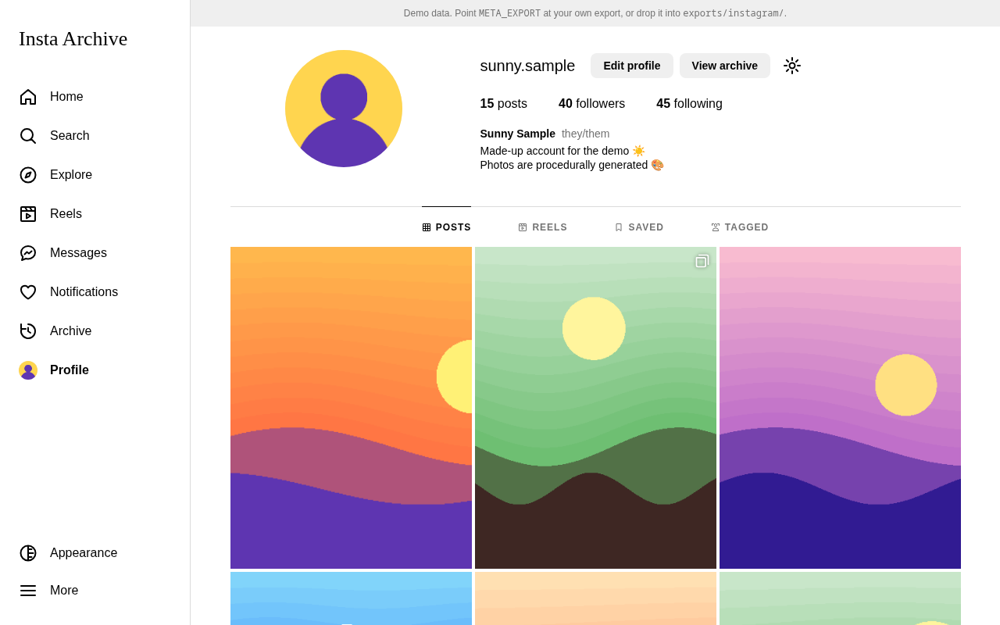
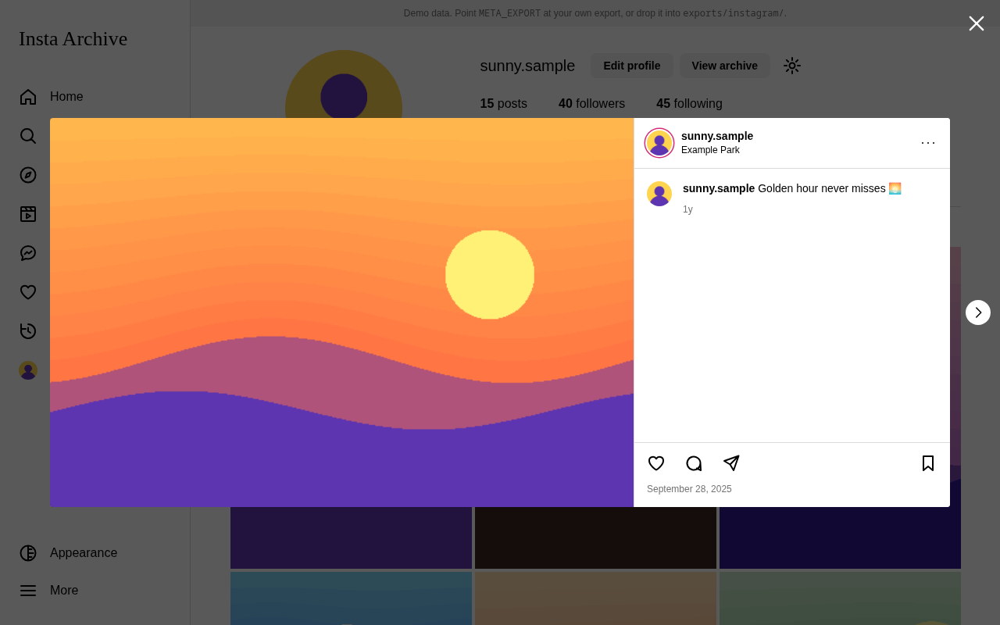
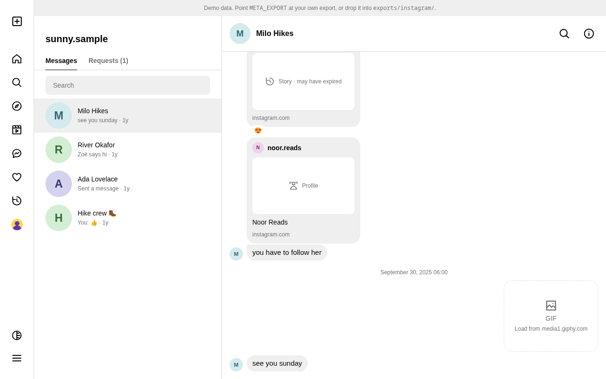
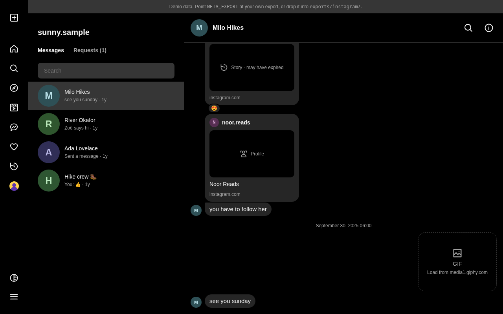
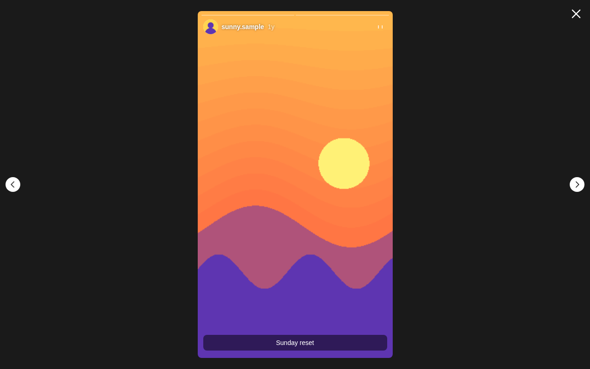
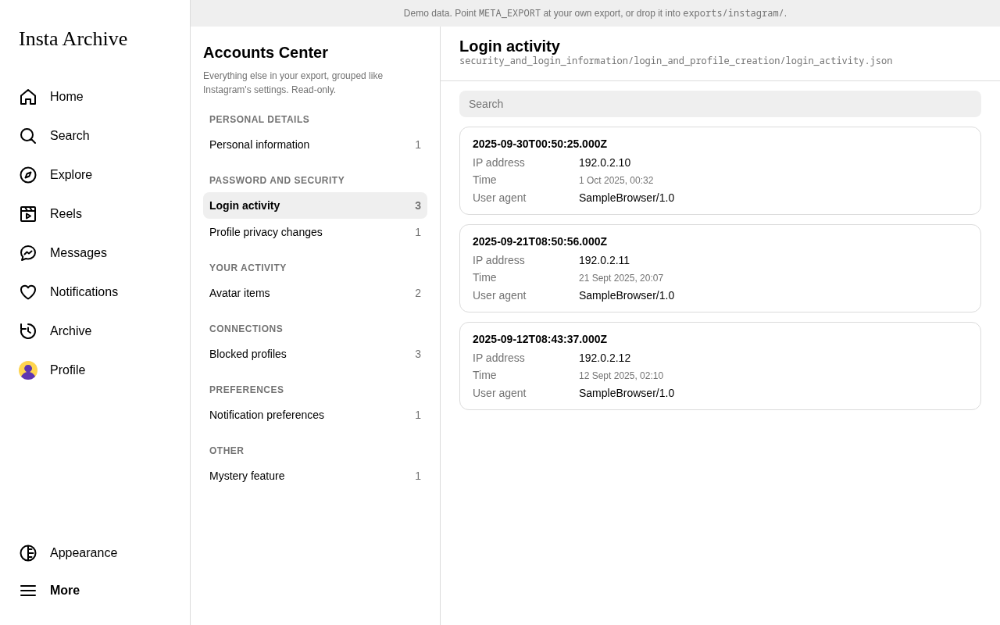

# meta-export-viewer

Browse your own **Instagram data export** in a familiar, logged-in-style interface,
entirely on your own machine. A Facebook viewer is planned and will share the same core.

| | |
| --- | --- |
|  |  |
|  |  |
|  |  |

<sub>Screenshots use the built-in demo account; every person and image in them is made up.</sub>

- Profile with post grid, carousels, video, captions, places
- Followers / following with search and "follows you" markers
- Archived posts
- Direct messages: inbox and requests, full chats with photos, video, voice notes, shared posts/reels,
  reactions; search by friend, across all chats, or within one chat
- Stories archive by month, with a full-screen viewer (progress bars, tap/arrow navigation, auto-advance)
- Accounts Center: every other file in your export (personal details, login activity, likes, comments,
  story interactions, blocked, close friends, ads, preferences…), grouped and searchable
- Light / dark / follow-the-OS theme (Appearance in the sidebar), phone-sized layout
- Keyboard friendly: Tab through everything, Enter opens, Esc closes, ←/→ between posts and stories,
  Space pauses a story, ↑/↓ moves through search results, Enter / Shift+Enter steps through in-chat matches
- Coming next: search across everything, an activity timeline, a reels player, then a Facebook viewer ([ROADMAP.md](ROADMAP.md))

> **Not affiliated with, endorsed by, or connected to Meta Platforms, Inc.** Instagram and
> Facebook are trademarks of Meta. This project uses no Meta code or assets; icons are original.

## Privacy

Your export contains private messages, contact details and login history. This viewer:

- runs only on `127.0.0.1` (not reachable from your network),
- reads your export folder **read-only** and never copies or uploads it,
- has no analytics and makes no external requests on its own. Links (a post's OpenStreetMap location, shared
  posts and links in messages) only open when you click them, and images that exist only on a remote server
  (some DM photos, GIFs) show a placeholder until you click "Load".

Keep your export out of the repo: `exports/` is gitignored.

## 1. Get your export (JSON)

Instagram app or website → **Accounts Center** → **Your information and permissions** →
**Download your information** → choose your Instagram account → **Download or transfer information** →
*All available information* (or pick what you want) → **Download to device** →
**Format: JSON**, **Media quality: High** → Create files.

You'll get an email when the download is ready (can take hours to days). Unzip all parts into one folder.

> An *HTML* export won't work: the viewer will tell you if it finds one.

## 2. Run it

Requires Node.js 22.18+ (24 recommended).

```sh
npm install

# either point at your extracted export…
META_EXPORT="/path/to/instagram-yourname-2026-01-01-xxxx" npm run dev:instagram

# …or drop the extracted folder into exports/instagram/ and just run
npm run dev:instagram
```

Open <http://127.0.0.1:5173>. With no export configured, it shows a built-in **demo account**
(`fixtures/instagram-sample/`, invented people and generated images).

## How it works

```
packages/core/      shared by every platform
  src/node/         export reading: mojibake repair, schema helpers, media-size sniffing,
                    Messenger-style thread loader (shared with Facebook), any-file → records converter,
                    Vite plugin that builds datasets in Node and serves /api/data/*.json + /export/*
  src/client/       Vue building blocks: Lightbox, Carousel, SearchableList, MediaView, useData, date formats,
                    RecordList, chat layout + accent-insensitive search helpers
apps/instagram/
  build/            Instagram export → profile / posts / archived / stories / followers / following /
                    threads / settings
  src/              the Instagram-style UI (Vue 3 + vue-router)
fixtures/           synthetic sample export + its generator (npm run fixture)
```

Meta exports store text as UTF-8 bytes escaped as latin-1 (`â\u0098\u0080` for ☀), and the schema
varies between export versions. The builders repair the text and tolerate missing or renamed sections.
If something in *your* export doesn't show up, please open an issue describing the file and its
structure (not its contents).

## Development

```sh
npm test            # vitest
npm run typecheck   # vue-tsc
npm run fixture     # regenerate the demo export
npm run leakcheck   # scan tracked files for personal data
```

### Keeping your data out of commits

`npm install` enables a pre-commit hook (`.githooks/pre-commit`). It blocks:

- anything under `exports/`, media files outside `fixtures/`, and absolute home-directory paths;
- your own identifiers (username, name, email, phone, media IDs), read at commit time from your
  export. Tell it where your export is in a gitignored `.leakcheck.local`:

  ```
  export=/path/to/your/instagram-export
  # or literal strings, one per line
  ```

Matches are reported by file only, never by value. CI runs the generic rules on every PR.

## License

MIT
